<div align="center">
<h1 align="center">VideoPrinterTurbo</h1>
<br>
<h3> <a href="README.md">English</a> | 简体中文</h3>
<br>
</div>


*** 🎉 1.0.1版本郑重发布，支持批量下载，最大100个链接，可以一个一个粘贴，也支持文本文件方式提交 **

*** 1.0.2 版本紧急发布，修复bilibili.com的下载问题 **

### 最新免安装版本

[[macOS] Apple Silicon](https://github.com/leftatrium2/VideoPrinterTurbo/releases/download/v1.0.2/VideoPrinterTurbo-1.0.2-macos-arm64.zip)

*** 解压后，直接运行***

[[windows]](https://github.com/leftatrium2/VideoPrinterTurbo/releases/download/v1.0.2/VideoPrinterTurbo-1.0.2-windows-x64.exe)

*** 无需解压，直接运行 ***

*** 作者为爱发电，好用给点个免费的 Star，不好用，提交一下 issue 给我***

### 免费视频下载工具，AI 字幕翻译与配音功能、二创

```
VideoPrinterTurbo 使用须知与免责声明

VideoPrinterTurbo 仅提供视频处理与辅助创作功能，不授予任何第三方内容的使用权。用户应确保素材及其使用方式合法，取得必要授权，并遵守相关平台规则；二次创作、注明来源或非商业使用不当然免除侵权责任。本工具按现状提供，不保证输出内容的准确性、合法性或适用性，用户应在发布前自行审核。因用户违法或侵权行为产生的责任由其依法承担。本声明不排除或限制开发者及提供方依法不得免除的责任。
```

### VideoPrinterTurbo 能做什么？

+ 视频下载

  + VideoPrinterTurbo 基于yt-dlp，可以支持大多数的视频网站视频下载
  
    具体参照：https://github.com/yt-dlp/yt-dlp/blob/master/supportedsites.md
  
  + 对于无法下载的视频，VideoPrinterTurbo 提供方便的插件方式

+ 视频 AI 翻译

  + 调用链：下载->ASR->LLM改写->字幕配置->输出成品
#### 原视频：

[](https://www.youtube.com/watch?v=E7YiKBeOneo&t=1s)

#### 增加翻译字幕后：

[](https://www.youtube.com/watch?v=AiSW3_SyaKs)

+ 视频 AI 重配音

#### 增加翻译字幕并重新配音：
[](https://www.youtube.com/watch?v=08dmRF8JVaI)

+ 视频全覆盖
#### 增加翻译字幕、重新配音并修改视频：
[](https://www.youtube.com/watch?v=321RVhF8ok8)

+ 其他……
  + 等待你发掘，有新的想法，请给我提交一下issue


### 配置要求
+ 硬件要求


| 项目 | 最低配置 | 推荐配置        | 理想配置        |
| ---- | -------- | --------------- | --------------- |
| CPU  | 4 核     | 6 到 8 核       | 8 核及以上      |
| RAM  | 12 GB  | 16 GB            | 16 GB 及以上    |
| GPU  | 非必须   | 12 GB 显存及以上 | 16 GB 显存及以上 |


+ 软件要求

  + Windows 10 或更高版本（64 位，x64 架构）
  + macOS 24 及以上版本（Apple Silicon）
+ 如何使用？

  + 找到符合自己当前操作系统最新版本的release包
  + 对于windows系统，直接点击 VideoPrinterTurbo-x.x.x-windows-x64.exe 
  + 对于macOS系统，先解压 VideoPrinterTurbo-x.x.x-macos-arm64.zip，然后运行 VideoPrinterTurbo

### 快速开始

+ 纯下载视频
  + 找到视频的播放页，比如：https://www.youtube.com/watch?v=LxPf_bzZXXw
  + 拷贝此 Url，打开 VideoPrinterTurbo，点击 “添加任务”，将Url 拷贝到 视频链接 中
	+ 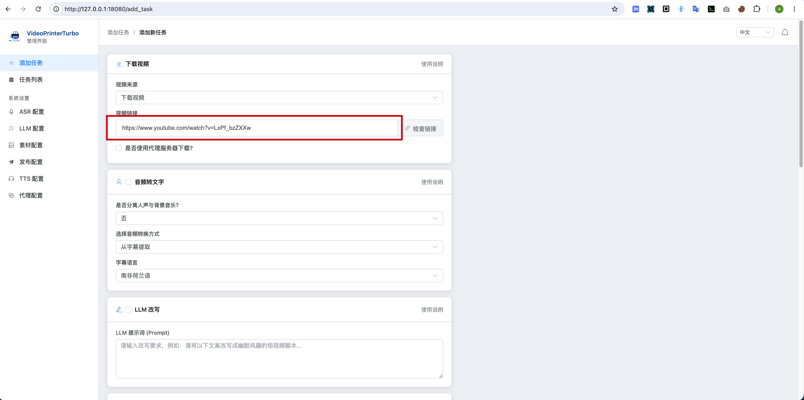
  + 点击“开始任务”
  + 打开 “任务列表”，刷新并等待任务结束，红色框中就是下载后的视频
  + 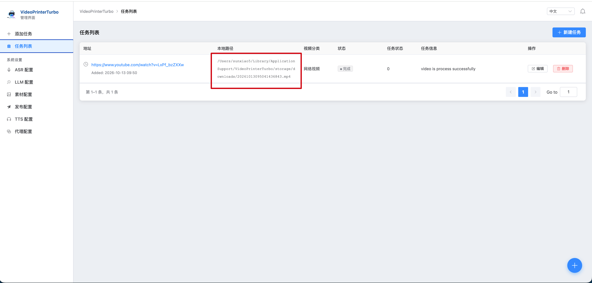
+ 纯下载视频（需要转接代理服务）
	+ 配置“代理”
	+ 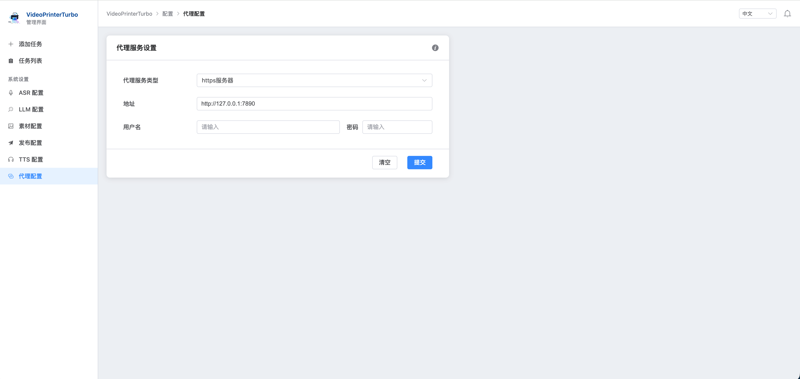
	+ 点击“开始任务”，其余步骤与上面一致，只是注意 打开 ”是否使用代理服务器下载“选项
	+ 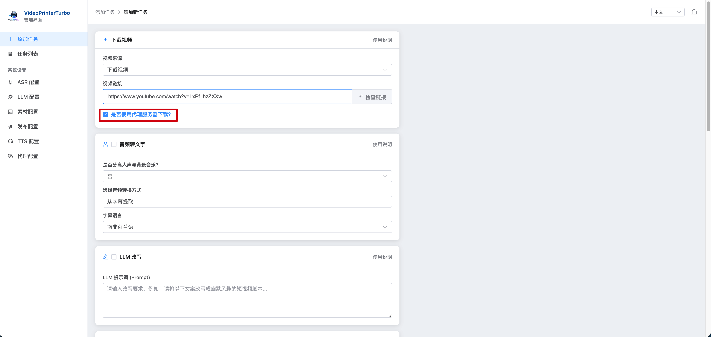
+ 下载视频，添加字幕翻译
  + 用途：给视频加上字幕翻译
  + 第一步：配置ASR
  + 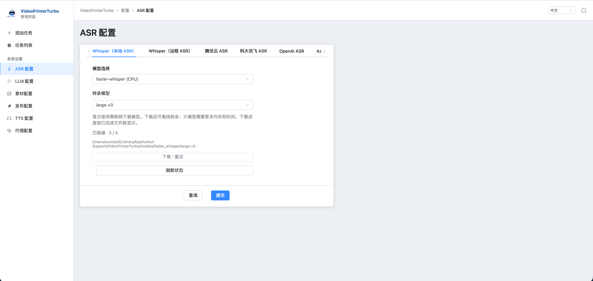
  + 第二步：配置LLM
  + 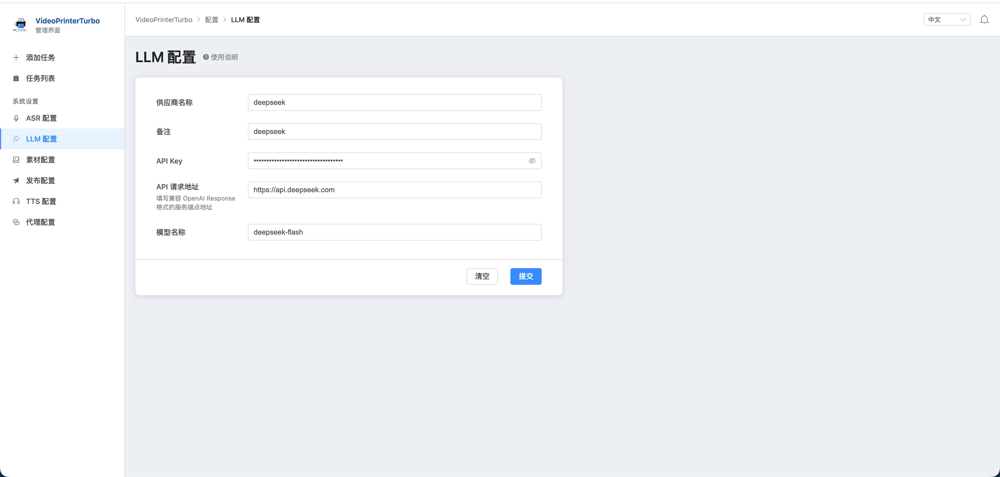
  + 第三步：按下面方式添加任务
  + 3.1 填写链接地址
  + 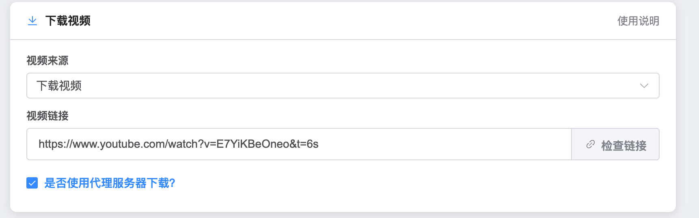
  + 3.2 选择”音频转文字“
  + 
  + 3.3 选择 ”LLM改写“
  + 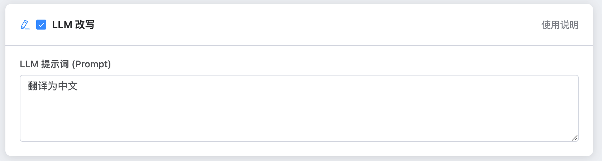
  + 3.4 选择 ”输出到字幕“
  + 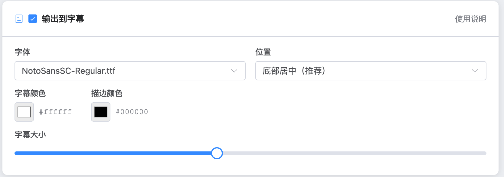
  + 点击”开始任务“
  + 在”任务列表“中，等待任务执行完毕，在 ”本地路径“ 中可以得到转换后的视频文件

### 教程
+ 如何配置 VideoPrinterTurbo
  + 关于ASR配置
    + 什么是ASR：
    
       ***\*ASR技术\****（**Automatic Speech Recognition**，即**自动语音识别**）是一种利用人工智能和机器学习技术，将人类的语音信号（声音）自动转换成对应书面文本或命令的智能化处理技术。
    
       VideoPrinterTurbo 用ASR技术来实现将视频中的人声部分，转换为文字，为后续的LLM、TTS等处理做准备
    
    + 如何配置？
    
       + 【备注：ASR配置的所有TAG项目，只要配置好一个，后续在新建任务的时候，选择配置好的这个ASR服务即可，不需要全部配置一遍】
	  
	  + 什么是 *** Whisper（本地 ASR）***以及如何配置？
		  + Whisper 是由 OpenAI 开源的用于语音识别和转录的机器学习模型，所谓 *** Whisper（本地 ASR）*** 指直接将 whisper 模型下载到本地机器
	    + OpenAI Whisper（CPU调用）
		    + 官方 whisper-large-v3-turbo 模型
	      + 使用CPU方式，速度较慢，只是作为兼容性使用，不建议用到真实业务里面
		    + 模型文件需要5GB以上硬盘空间
      + MLX Whisper（推荐 Apple Silicon 选用）
        + 使用：mlx-community/whisper-large-v3-mlx
        + 模型文件需要5GB以上的硬盘空间
        + 建议M pro系列CPU
        + 建议16GB以上统一内存
      + Faster Whisper（推荐 NVIDIA GPU 选用）
        + 使用：Systran/faster-whisper-large-v3模型
        + 建议显存12GB以上，显卡：3080以上
        + 模型文件建议5GB以上硬盘空间
      
    + 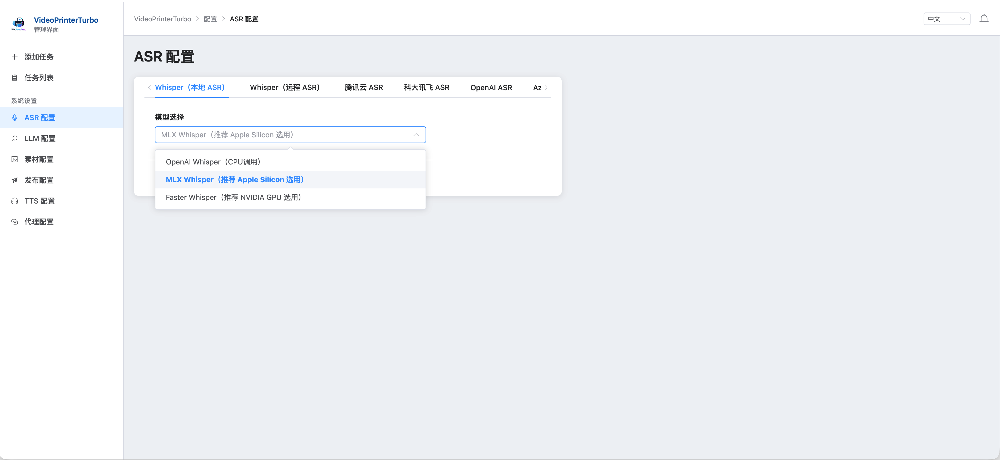
    
    + 什么是 *** Whisper（远程 ASR）***以及如何配置？
    
    + 所谓 *** Whisper（远程 ASR）***指的是，私有化部署在服务器上面的Whisper服务，本项目支持 vllm 与 whisper.cpp 两种部署方式
    
    + 按照部署后的地址，填写即可，比如，whisper.cpp部署在 192.168.0.1 服务器上面，端口是8004，那么地址是：http://192.168.0.1:8004/inference
    
    + 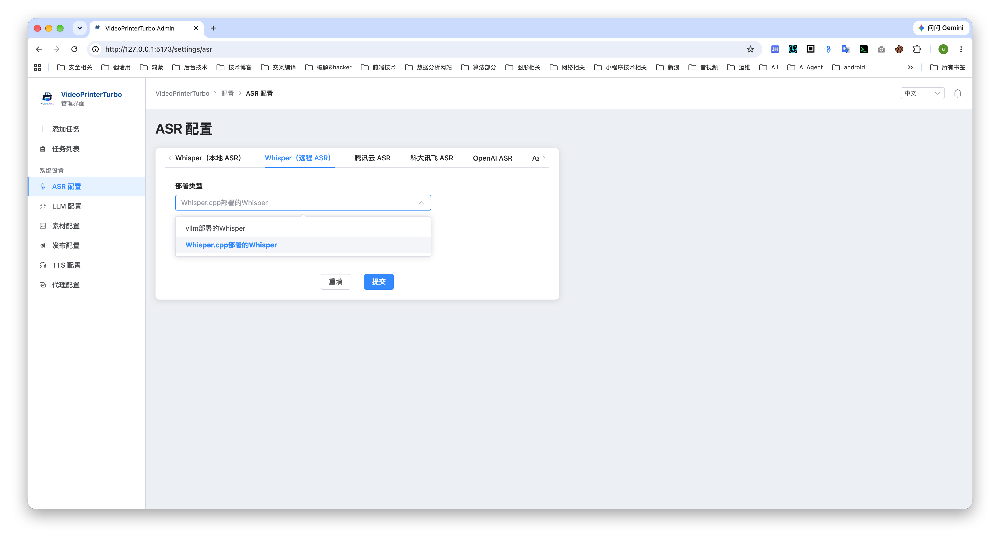
    
    + 什么是 *** 腾讯云 ASR***以及如何配置？
    
    + 按照各云厂商提供的id与key，填写即可
    
    + 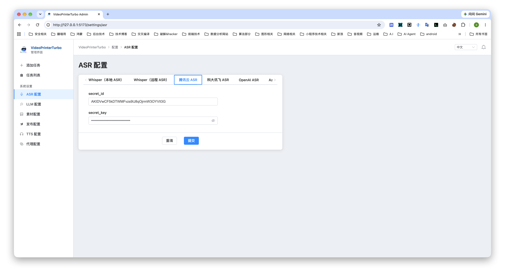
    
    + 其余云服务配置，参照腾讯云ASR配置方式，不再赘述
    
  + 关于LLM配置
  
    + 什么是LLM配置：LLM用来改写字幕文件，并影响到后续的AI语音（TTS）等输出的内容
    + 本项目使用的LLM配置为 openai 的兼容方式，不支持 Claude API调用方式
    + 下面是使用Deepseek官方API的例子
    +  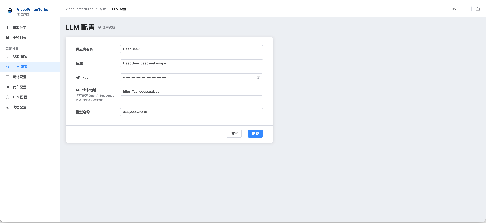
  
  + 关于素材配置
	
    + 什么是素材？
      + 在一些特殊的二创场景，比如：我自己用 MoneyPrinterTurbo 做了一个短片，我希望快速复制类似的内容，那么可以使用 素材 功能
      + 在”添加任务“的时候，选中 视频覆盖 功能，并在 视频关键词 中填写相应的关键词后，VideoPrinterTurbo 会从相应站点，按照给定的关键词搜索后，将得到的素材替换到原视频中的视频部分，以达到快速二创的目的
      + 【备注：如果不填写关键词，那么 VideoPrinterTurbo 会使用LLM（需要有LLM配置）将当前字幕文件中的内容，提取固定数量的关键词，这可能导致关键词不准确】
    + 如何配置
      + 本项目支持 Pexels 与 Pixabay 两个素材站的素材 apikey 配置
      + 在相应的网站申请 apikey 即可
  
  + 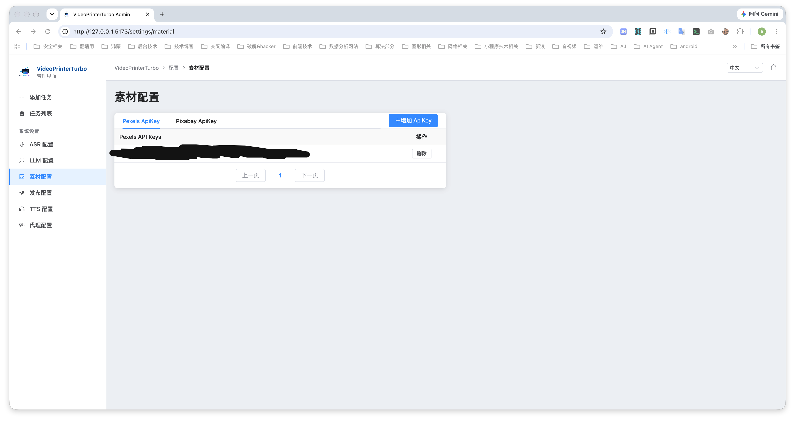
  
  + 关于TTS配置
  
    + TTS是什么？
      + ***\*TTS\**** 是 **Text-to-Speech（文本转语音）**的缩写，也叫语音合成技术。它是一种能把书面文字转换成自然、可听见的人类语音的技术。
      + 你可以理解为ASR的相反过程，在 VideoPrinterTurbo 项目中，TTS技术用于将 ASR提取后，并经过LLM处理后的字幕，重新输出为语音，并在最后合并到输出视频中
    + 如何配置？
      + 在 *** TTS服务器 *** 中选择你需要的，建议选择 Azure TTS V2 服务，相对来说，速度与流畅度都不错，只是注意，在申请 Azure TTS V2云服务的时候，记得选择离你最近的 *** 服务区域*** ，并正确填写到配置里面
  
  + 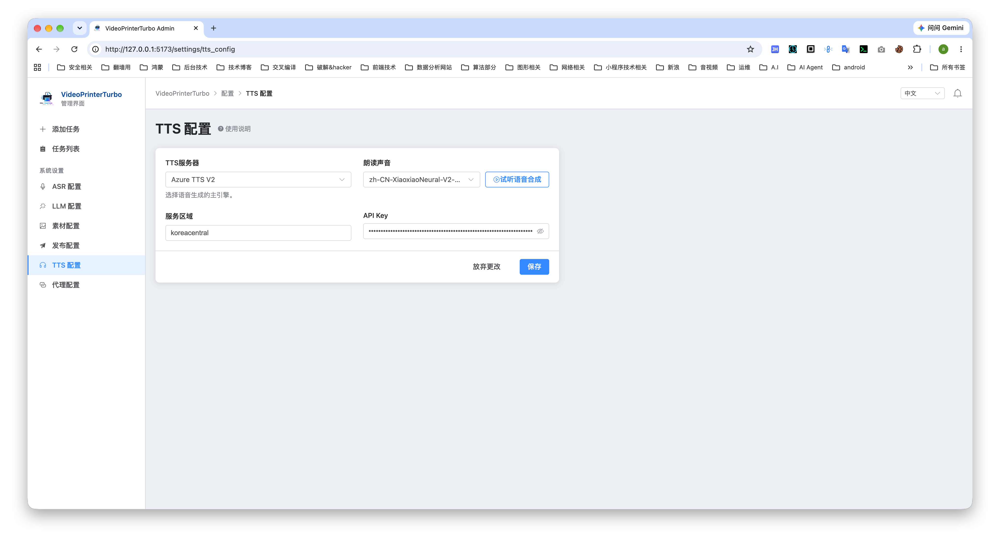
  
  + 关于代理配置
  
    + 支持 http 代理以及 socks5 代理
  
    + 【备注：一旦配置后，可以在”添加任务“中选中，选中后，所有的网络部分都会走配置的代理服务】
  
  + 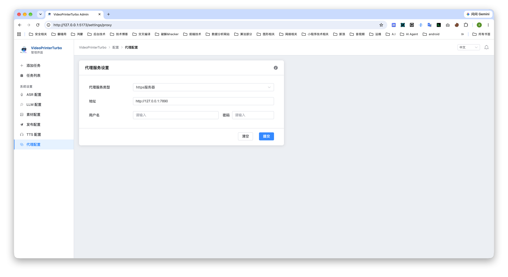
  
+ 开始第一个任务

  + 全部配置完毕后，我们开始第一个最简单的任务，下载视频：
  + 点击”添加任务“
  + 在下载视频中填写链接，比如：https://www.youtube.com/watch?v=mUw27wG7uFA
  + 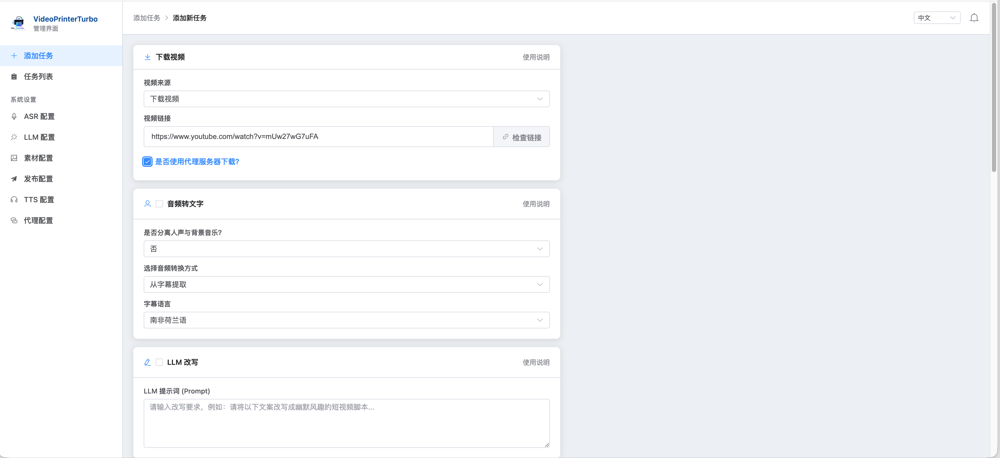
  + 点击”检查链接“，检查链接是否可用【备注：如果你想要下载的视频，必须使用代理服务下载，那么在”检查链接“的时候，也需要选中代理服务下载】
  + 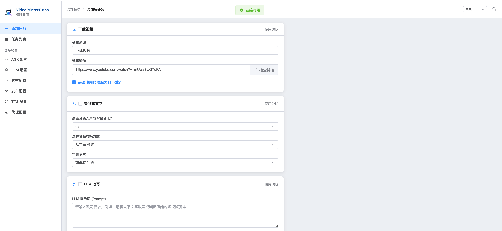
  + 检查通过，点击最下面的：开始任务 按钮，开始下载
  + 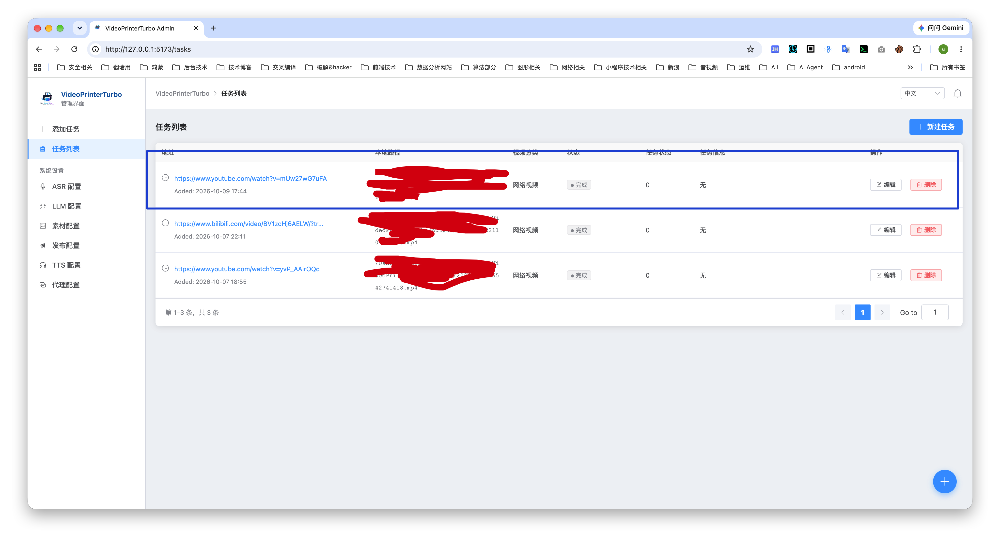
  + 等待任务完成，当”状态”显示完成后，在本地路径中显示的，就是下载得到的视频
  
+ 如何卸载？
	+ 对于直接下载的二进制包：
		+ 第一步：删掉下载的文件
		+ 第二步：
    	+ macOS系统中：~/Library/Application Support/VideoPrinterTurbo，将此目录删掉
        + 打开 访达 ，点击顶部菜单中的 前往，再点击 前往文件夹... 
		    + 将 ~/Library/Application Support/VideoPrinterTurbo 粘贴进去
			  + 在打开的窗口中，可以查看 VideoPrinterTurbo 所有创建的文件
			  + 其中 output 文件夹是下载以及最后处理完成的MP4文件
			+ windows系统中：C:\Users\[你的用户名]\AppData\Local\VideoPrinterTurbo，将此目录删掉
			  + 同样，在output 文件夹是下载以及最后处理完成的MP4文件
		
		

### 后续计划
+ 有其他的需求，给我提交一下issue


### 感谢

+ https://github.com/yt-dlp/yt-dlp
+ https://github.com/openai/whisper
+ https://github.com/streichgeorg/python-audio-separator

